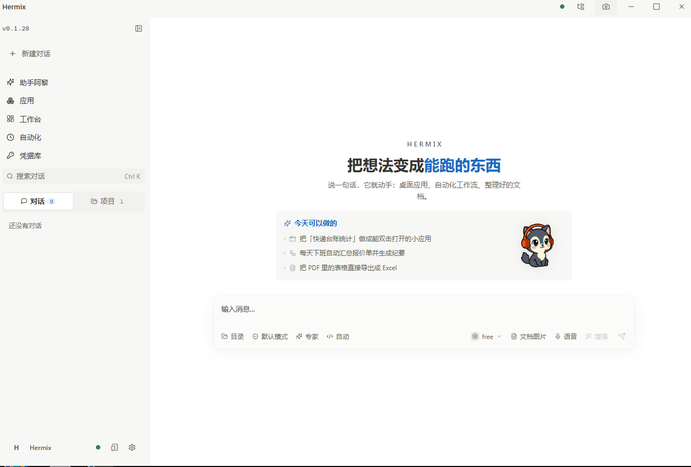
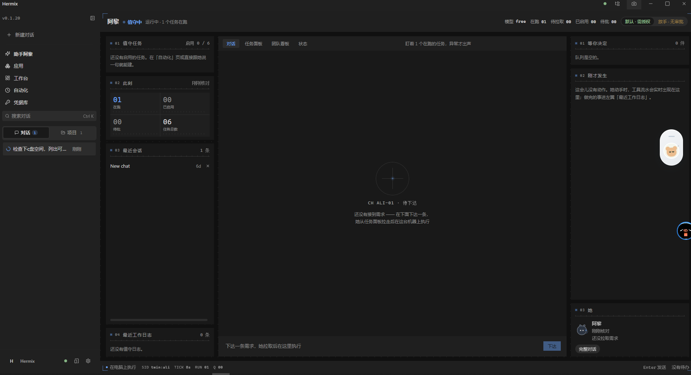
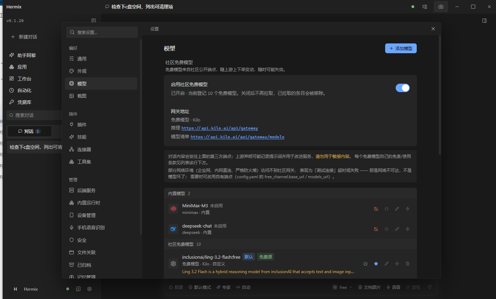
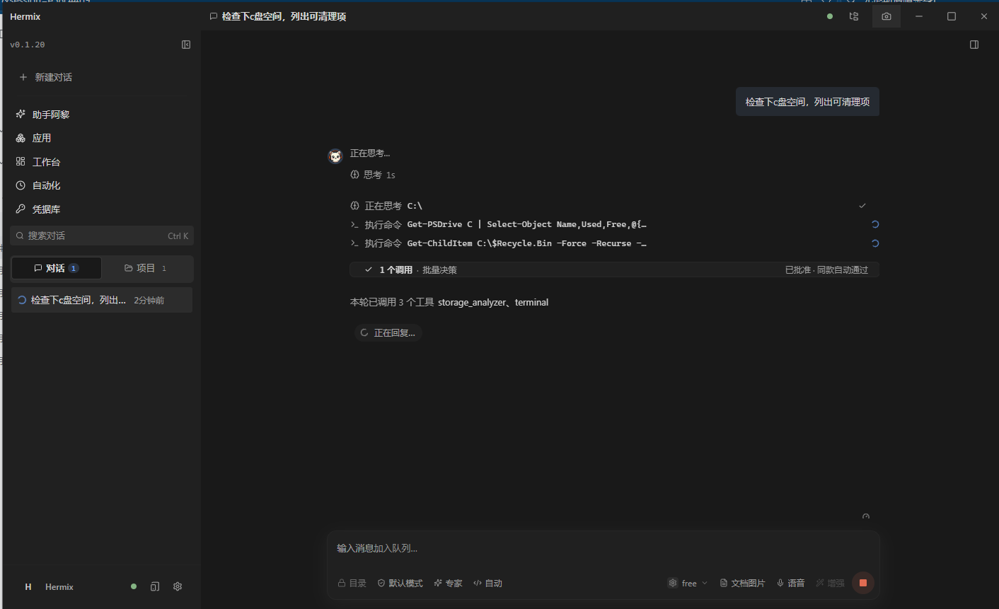

<div align="center">

# Hermix Desktop

[](https://github.com/RichardLitt/standard-readme)
[](apps/desktop-tauri/src-tauri/LICENSE.txt)

本地优先的 Windows 桌面 AI 助手：Rust 后端 + React 前端，经 Tauri v2 打包为便携应用；对话、工具执行、定时自动化与手机伴侣端全部在本机闭环。

**Windows x64（MSVC）单平台**，无跨平台目标，无云服务依赖——会话、记忆与文件索引全部落在本机数据目录，删除安装目录即完成卸载。

</div>

## 目录

- [界面截图](#界面截图)
- [背景](#背景)
- [安装](#安装)
- [用法](#用法)
- [仓库结构](#仓库结构)
- [构建与验证](#构建与验证)
- [发版](#发版)
- [如何贡献](#如何贡献)
- [许可证](#许可证)

## 界面截图

|  |  |
| :---: | :---: |
| *对话主界面（浅色）* | *Twin 工作台（深色）* |
|  |  |
| *模型设置* | *工具执行与审批* |

## 背景

AI 助手的能力（执行命令、操作文件、定时任务）通常锁在浏览器或云端服务里：数据不在自己手里，能力也无法按自己的方式扩展。Hermix 把整个 agent 跑在本机：

- **本地优先**：后端是本机拉起的 `hermix` sidecar 进程（axum，`127.0.0.1:3000`），数据不依赖任何云端托管；
- **能力闭环**：对话、工具执行（终端 / 文件 / 截图 / 浏览器等 30+ 工具）、子代理派发、审批引擎、上下文压缩、定时自动化都在本机完成；
- **用户自造能力**：Custom App 以自然语言或模板生成真代码应用——独立窗口、真分发、可复用技能；
- **手机伴侣端**：`apps/hm`（uni-app）扫桌面端二维码配对，经自建 relay 中转、全程端到端加密，**不要求同一网络**。

LLM 推理由用户在设置里自行配置的云端服务商完成（内置十余家厂商注册表 + 自定义 OpenAI 兼容接入），对应费用是用户与服务商之间的结算。

## 安装

### 最终用户

从[官网](https://hermix.cssso.com/desktop.html)下载安装包（NSIS）。应用内置自动更新（从同域 `desktop/manifest.json` 取更新）。便携设计：不写系统注册表、不留残留，删除安装目录即卸载。

> **域名说明**：`hermix.cssso.com` 仅为开发测试使用的中转域名（官网、手机端 relay 与更新源都挂在它上面），**仅作测试用途，不保证可用性**。正式使用请部署自己的 relay（源码在 `apps/relay/`），客户端域名可通过自有 relay 与更新 manifest 配置。

### 开发者

环境要求：

- Windows 10+ x64，Rust stable MSVC 工具链。MSVC linker（rust-lld 与 LIBPATH）已在 `.cargo/config.toml` 写死，任何终端直接用 `cargo` 即可，无需额外环境脚本
- Node.js ≥ 20 与 npm（仅前端需要）

```bash
cargo check --workspace --all-targets   # 全量编译检查（应为 0 error / 0 warning）
cargo test --workspace --lib            # 全部单元测试（约 1,800 个）
```

## 用法

启动即可对话。常用入口：

- **模型设置**：多 provider 注册表 + 自定义 OpenAI 兼容端点；会话内模型选择以后端 `/api/model/list` 为持久权威，`/api/providers/meta` 做厂商分组
- **审批引擎**：高危工具调用（删除、命令执行等）需用户批准；可选「允许这一次 / 总是允许 / 放手模式（本会话后续调用不再申请）」
- **手机配对**：`apps/hm` 手机端扫桌面端二维码，远程指挥、审批与通话
- **自动化**：cron/rrule 定时任务、SQL 条件提醒（零 LLM 扫描）、LLM 定时总结
- **Custom App**：自然语言生成真代码应用（运行时 `apps/hx-shell`，打包 `apps/hx-packager`）

前端与外部调用共用同一套 HTTP/WebSocket API（`127.0.0.1:3000`）——Tauri 主进程把 `hermix` 作为 sidecar 拉起，无独立后端部署。

## 仓库结构

```
├── Cargo.toml                 # cargo workspace（resolver = 2）
├── crates/                    # 24 个 Rust crate
│   ├── hermix-core            # 接缝定义（Fs/Shell/ExecWorld/Sandbox/Transport + ToolHandler）与 boot
│   ├── hermix-agent           # Agent 循环内核：run_loop / 上下文分层 / 子代理编排
│   ├── hermix-tools           # 30+ 工具后端 + 审批引擎 + 凭证防护
│   ├── hermix-server          # axum HTTP/WS API；产出二进制 hermix（sidecar 入口）
│   └── …                      # config / session / store / context / mcp / automation / cron /
│                              #   voice / task / plugin / environments / filesearch / focus /
│                              #   vault / protocol / runtime / intelligence / skills / telemetry …
├── apps/
│   ├── desktop-tauri/         # Tauri v2 桌面壳（src-tauri 为 Tauri 主程序 crate hermix-desktop）+ React 19 / Tailwind 4 / Vite 前端
│   ├── hm/                    # 手机伴侣端（uni-app，见其 README）
│   ├── relay/                 # 自建中转服务 + 官网静态页 + 更新源
│   ├── hx-shell/              # Custom App Shell 运行时
│   ├── hx-packager/           # 自定义应用打包工具
│   └── playground/            # 前端实验场
├── sdk/                       # 协议黄金样本 + TypeScript 类型包
├── scripts/                   # ci-gate.sh、release.sh、各种卫生/门禁脚本
├── docs/notes/                # 决策笔记唯一入口（proposed / implemented / rejected / archived）
├── AGENTS.md                  # 贡献者约定、六步决策阶梯、核心原则——改码前必读
└── CHANGELOG.md               # 发布脚本取版本段作为更新说明
```

## 构建与验证

```bash
cd apps/desktop-tauri
./node_modules/.bin/tsc --noEmit   # 前端类型检查（约 25s，见下方警告）
./node_modules/.bin/vitest run     # 前端测试
```

```bash
./scripts/ci-gate.sh               # 仓库根：CI 总闸——编译 + 测试 + tsc + 笔记/卫生/侧车门禁
```

> **类型检查必须直接调 `node_modules/.bin/tsc`。** `pnpm tsc --noEmit` 是假信号——它只跑 pnpm 自己的 install 流程就返回（约 0.8s、输出 `Already up to date`、exit 0），类型检查压根没执行。

构建产物统一落在仓库根 `target/`（`target/`、`node_modules/`、运行时数据目录均已 gitignore）。sidecar 刷新的唯一入口是 `npm run ensure-sidecar`（`npm run build` 与 `cargo tauri build` 的 `beforeBuildCommand` 都已挂载），**禁止绕过它手工 copy**；打包前跑 `./scripts/check-sidecar-freshness.sh`（exit 1 即过期）。

## 发版

`scripts/release.sh` 一次构建产出**安装包 exe**（NSIS）与**更新包 zip**（+ sha256 + `manifest.json`），上传到自建 relay 的 `public/desktop/`；客户端默认从 `https://hermix.cssso.com/desktop/manifest.json` 取更新。手机端 APK 由 HBuilderX 云打包后人工放到 `public/hermix.apk`。

```bash
./scripts/check-sidecar-freshness.sh        # 门禁必须 exit 0；STALE 就先 npm run ensure-sidecar
npm run build                               # 前端 + ensure-sidecar
cargo build --release -p hermix-desktop     # 主程序
./scripts/release.sh --skip-build --skip-upload   # 组装 latest.zip + manifest + NSIS 安装包
```

官网是 `apps/relay/public/` 下的多页静态站，随 relay 部署、无独立构建。两条硬规则：**版本号不写死**（运行时 fetch 同域 `desktop/manifest.json` 等，与客户端「检查更新」同源；取不到显示「未发布」，不回填假版本号）；**静态托管必须挂在所有显式路由之后**（否则更新 manifest 丢失校验头与 no-cache，退化成裸 JSON，客户端更新链路静默失效）。

## 如何贡献

问题与 PR 均欢迎（GitHub 仓库，PR 模板见 `.github/PULL_REQUEST_TEMPLATE.md`）。改动要求：

- 附带验证证据：`cargo check` + 受影响 crate 的测试 + `node_modules/.bin/tsc --noEmit`；提交前跑 `scripts/ci-gate.sh`
- 单文件超过 2500 行会被 CI 门警告；新增依赖遵循「标准库 > 平台原生 > 已有依赖」阶梯
- 影响代码库的持久决策写入 `docs/notes/` 三态（proposed / implemented / rejected），不得新建顶层 `docs/XXX_PLAN.md`
- 错误要精准暴露，禁止静默吞结果；跨入口不变量放单一分发点强制，不做「每个入口各自记得检查」

详见 [AGENTS.md](AGENTS.md)（六步决策阶梯、核心原则）。

## 许可证

[MIT](apps/desktop-tauri/src-tauri/LICENSE.txt) © 2026 Hermix（hermix.cssso.com）

许可文件为《Hermix Desktop 许可协议》：免费使用、免登录、数据不出本机；第三条按 MIT 许可证授予使用、复制、修改与分发权。
