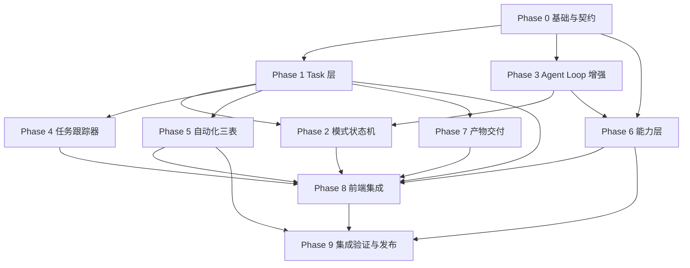

# Hermix 编排引擎开发计划（参考 WorkBuddy 架构）

Archived: 2026-09-30

> 目标形态：**在现有 18-crate Rust + React 19 + Tauri v2 workspace 内增量落地 WorkBuddy 编排引擎架构**，复用 `agent_loop`，补齐外围三件套（Task 层 / 自动化三表 / 产物交付层）与模式状态机。
> 本文档为**可操作开发计划**：每个任务拆分到模块级 + 功能点级，指定技能角色、依赖关系、执行顺序与估时。开发者可直接据此编码。

---

## 0. 参考架构基线（必须对齐，禁止遗漏）

计划严格覆盖 WorkBuddy 架构的 8 个设计点（见对话中的两张图：分层架构图 + 任务生命周期状态机）：

| # | 设计点 | 本计划对应阶段 |
|---|---|---|
| 1 | Task 一等公民（workspace/conversation/context/results） | Phase 1 |
| 2 | 工作模式状态机 Craft/Plan/Ask（Task 级） | Phase 2 |
| 3 | Agent Loop 四阶段显式化 + 收敛分级（advisory / hard-stop） | Phase 3 |
| 4 | 任务跟踪器（用户可见进度 + 自我防遗漏） | Phase 4 |
| 5 | 自动化三表（定义/运行时/历史）调度与引擎解耦 | Phase 5 |
| 6 | 能力层四件套（工具延迟加载 / 技能 / 多智能体 / 自动化） | Phase 6 |
| 7 | 产物交付统一出口（present_files 等价物） | Phase 7 |
| 8 | 前端集成（任务面板 / 模式切换 / 结果面板 / 自动化 UI） | Phase 8 |
| — | 基础与契约（共享类型 / 事件总线 / 持久化底座） | Phase 0 |
| — | 集成验证与发布（parity / CI gate / 构建） | Phase 9 |

**技术栈假设（与现有 workspace 一致）**：后端 Rust（Tokio + Axum + SQLx + SQLite），前端 React 19 + TypeScript + Tauri v2，持久化复用现有 `sessions.db` / `memory.db` 同一 SQLite 实例（遵守铁律 D/WAL、双写者一致）。若需改栈，先回 Phase 0 修订契约。

---

## 1. 技能角色定义（RACI 主责）

| 角色代码 | 角色 | 职责范围 |
|---|---|---|
| **AR** | 架构师 | 模块边界、接口契约、状态机、事件协议、跨 crate 评审 |
| **BE** | Rust 后端工程师 | crate 实现、持久化、编排核心、HTTP/WS、能力层 |
| **FE** | 前端 TS 工程师 | React 组件、任务面板、模式切换、结果面板、自动化 UI |
| **QA** | 测试工程师 | 单元测试、集成测试、parity fixtures、CI gate 验收 |
| **REL** | 构建/发布 | Tauri bundle、sidecar 同步（铁律 PP）、CI gate 脚本 |
| **TW** | 技术文档 | 本计划维护、模块 README、API 文档 |

---

## 2. 总体阶段路线图与依赖



**执行波次（并行建议，假设 4–5 人团队）**：

- **Wave 1**：Phase 0（基础）+ Phase 3 内核增强（可并行，因 Loop 已存在）
- **Wave 2**：Phase 1（Task 层）单独成线；Phase 6 在 P3 完成后启动
- **Wave 3**：Phase 2 / Phase 4 / Phase 5 / Phase 7（均依赖 Phase 1，可并行）
- **Wave 4**：Phase 8 前端（依赖 1/2/4/5/7 的 API 落地）
- **Wave 5**：Phase 9 集成验证与发布（依赖全部）

**总估时（人日）**：约 **63 人日**；4–5 人并行排期约 **14–16 周**（含联调与缓冲）。

---

## 3. 数据模型（直接建表，Phase 0/1/5 落地）

### 3.1 Task 表（新建 `tasks` 表，入 `sessions.db`）

```sql
CREATE TABLE tasks (
  id              TEXT PRIMARY KEY,
  title           TEXT NOT NULL,
  workspace_path  TEXT NOT NULL,
  mode            TEXT NOT NULL DEFAULT 'craft',   -- craft|plan|ask
  status          TEXT NOT NULL DEFAULT 'pending', -- pending|planning|in_progress|completed|failed|archived
  parent_task_id  TEXT NULL,                        -- 多智能体子树
  context_json    TEXT NOT NULL DEFAULT '{}',       -- @引用/截图/上传文件
  result_refs_json TEXT NOT NULL DEFAULT '[]',      -- present_files 产物引用
  created_at      INTEGER NOT NULL,
  updated_at      INTEGER NOT NULL
);
CREATE INDEX idx_tasks_status ON tasks(status);
CREATE INDEX idx_tasks_parent ON tasks(parent_task_id);
```

### 3.2 自动化三表（新建 `automation_*` 表，入 `sessions.db`）

```sql
CREATE TABLE automations (
  id            TEXT PRIMARY KEY,
  name          TEXT NOT NULL,
  prompt        TEXT NOT NULL,
  schedule_type TEXT NOT NULL,            -- recurring|once
  rrule         TEXT NULL,                -- RRULE 字符串
  scheduled_at  TEXT NULL,                -- ISO8601（once）
  status        TEXT NOT NULL DEFAULT 'ACTIVE', -- ACTIVE|PAUSED
  valid_from    TEXT NULL,
  valid_until   TEXT NULL,
  cwds          TEXT NULL,
  connector_ids_json TEXT NULL,
  expert_id     TEXT NULL,
  model_id      TEXT NULL,
  created_at    INTEGER NOT NULL,
  updated_at    INTEGER NOT NULL
);
CREATE TABLE automation_runtime_state (
  automation_id TEXT PRIMARY KEY,
  last_run_at   INTEGER NULL,
  next_run_at   INTEGER NULL,
  run_count     INTEGER NOT NULL DEFAULT 0,
  FOREIGN KEY(automation_id) REFERENCES automations(id) ON DELETE CASCADE
);
CREATE TABLE automation_runs (
  id            TEXT PRIMARY KEY,
  automation_id TEXT NOT NULL,
  started_at    INTEGER NOT NULL,
  finished_at   INTEGER NULL,
  status        TEXT NOT NULL,            -- success|failed|timeout
  task_id       TEXT NULL,                -- 触发生成的 Task
  error_text    TEXT NULL,
  FOREIGN KEY(automation_id) REFERENCES automations(id) ON DELETE CASCADE
);
```

### 3.3 共享枚举（落 `hermix-core/src/traits.rs` 或新建 `hermix-task/src/types.rs`）

```rust
#[derive(Debug, Clone, Copy, PartialEq, Eq, Serialize, Deserialize)]
pub enum TaskMode  { Craft, Plan, Ask }

#[derive(Debug, Clone, Copy, PartialEq, Eq, Serialize, Deserialize)]
pub enum TaskStatus {
  Pending, Planning, InProgress, Completed, Failed, Archived
}
// 与现有 agent_loop::LoopPhase（9 阶段）共存：LoopPhase 为循环内细粒度，
// TaskStatus 为 Task 级粗粒度；二者通过编排核心映射，不互相替代。
```

---

## 4. 分阶段任务明细

### Phase 0 — 基础与契约（估时 5 人日，AR+BE）

**目标**：确立跨 crate 契约，提供持久化底座与事件总线，不写业务。

| 任务ID | 模块 | 功能点 | 角色 | 依赖 | 估时 | 交付物 |
|---|---|---|---|---|---|---|
| P0-1 | `hermix-core` | 定义 `TaskMode` / `TaskStatus` / `TaskContext` / `TaskResultRef` 共享类型 | AR/BE | — | 1d | 类型定义 + 单测 |
| P0-2 | `hermix-config::paths` | 新增 `tasks_db_path()` 复用 `hermix_home()`（铁律 B，禁 `dirs::home_dir`） | BE | — | 0.5d | 路径函数 |
| P0-3 | `hermix-server` | 新建 SQLite 迁移：`tasks` + `automation_*` 三表；开 WAL+synchronous=NORMAL（铁律 D） | BE | P0-2 | 1d | 迁移脚本 + 测试 `tempfile` |
| P0-4 | `hermix-core` | 扩展 `StreamEvent`：新增 `TaskCreated`/`TaskUpdated`/`TaskStatusChanged`/`AutomationTriggered`/`ResultDelivered` | AR/BE | P0-1 | 1d | 事件枚举 + 编解码 |
| P0-5 | `hermix-server` | 跨 crate 事件总线封装（铁律 DD 四步：transport→tools→register→HttpServerState+WS listener） | BE | P0-4 | 1.5d | 总线模块 + 集成测试 |

**退出标准**：`cargo test -p hermix-core --lib` 通过；三表可建；新 `StreamEvent` 能经 WS 透传。

---

### Phase 1 — Task 一等公民层（估时 8 人日，BE 主，AR 审）

**目标**：实现设计点 1。Task 成为顶层工作单元，携带 workspace/conversation/context/results。

| 任务ID | 模块 | 功能点 | 角色 | 依赖 | 估时 | 交付物 |
|---|---|---|---|---|---|---|
| P1-1 | `hermix-task`（新 crate） | `Task` 领域结构 + `TaskRepository`（SQLx CRUD） | BE | P0-1,P0-3 | 2d | repo + 单测 |
| P1-2 | `hermix-task` | `TaskService`：创建/查询/更新/归档；生命周期转移校验（状态机合法迁移） | BE | P1-1 | 2d | service + 状态机单测 |
| P1-3 | `hermix-task` | context 模型：`@` 引用解析、截图、上传文件落 `context_json` | BE | P1-1 | 1.5d | 解析器 + 测试 |
| P1-4 | `hermix-task` | results 模型：`TaskResultRef` 集合，支撑 `present_files` 等价归集 | BE | P1-1 | 1d | 模型 + 测试 |
| P1-5 | `hermix-server` | HTTP/WS：`POST /tasks`、`GET /tasks/:id`、`PATCH /tasks/:id/status`、`GET /tasks`（列表+筛选） | BE | P1-2,P0-5 | 1.5d | 端点 + 集成测试 |

**退出标准**：可经 API 创建 Task、注入 context、挂 results、查列表；状态非法迁移被拒。

---

### Phase 2 — 工作模式状态机（估时 4 人日，BE+FE）

**目标**：实现设计点 2。Task 级 Craft/Plan/Ask 决定引擎是否阻塞等确认。

| 任务ID | 模块 | 功能点 | 角色 | 依赖 | 估时 | 交付物 |
|---|---|---|---|---|---|---|
| P2-1 | `hermix-task` | `mode` 落 Task；`pending→planning`（仅 Plan）、`pending→in_progress`（Craft）、Ask 不进执行态 | BE | P1-2 | 1d | 模式转移规则 + 测试 |
| P2-2 | `hermix-orchestrator`（扩展 `agent_loop`） | 模式门控：Plan 模式在 `process_post_response` 前插入"待确认"暂停点；Ask 模式禁用写入类工具（铁律 M/K） | BE | P2-1,P3-2 | 1.5d | 门控逻辑 + 测试 |
| P2-3 | `apps/desktop-tauri/src` | 模式选择器组件（Craft/Plan/Ask），创建任务时绑定 `mode` | FE | P2-1 | 1d | 组件 + 类型 |
| P2-4 | `apps/desktop-tauri/src` | Plan 模式"方案确认"弹层，确认后才 `PATCH status→in_progress` | FE | P2-3 | 0.5d | 弹层组件 |

**退出标准**：三种模式经 API + UI 正确切换状态路径；Ask 模式无法触发写操作。

---

### Phase 3 — Agent Loop 显式化 + 收敛分级（估时 6 人日，BE，AR 审）

**目标**：实现设计点 3。四阶段可观测 + 收敛策略分 advisory / hard-stop。复用现有 `LoopPhase`/`convergence_detector`/`tool_call_validator`/`turn_report`。

| 任务ID | 模块 | 功能点 | 角色 | 依赖 | 估时 | 交付物 |
|---|---|---|---|---|---|---|
| P3-1 | `agent_loop/types.rs` | 维持 `LoopPhase` 9 阶段；新增 `LoopPhase::as_orchestration_stage()` 映射到 感知/推理/行动/观察 | BE | P0-1 | 1d | 映射函数 + 测试 |
| P3-2 | `agent_loop/run.rs` | 在每个阶段边界发射 `tracing::debug!` + 经事件总线发 `LoopPhaseChanged`（铁律 AL-6） | BE | P3-1 | 1d | 埋点 + 测试 |
| P3-3 | `agent_loop/convergence_detector.rs` | 收敛分级：`NoProgressWithTools`/`SimilarContent` = advisory（注入系统提示，LLM 自决）；仅 `ErrorLoop` = hard stop（铁律 AL-8） | BE | — | 2d | 策略 + 单测 |
| P3-4 | `agent_loop/turn_report.rs` | `TurnReport` 增补 `mode` / `task_id` / `stage` 字段，序列化可观测 | BE | P3-1,P1-1 | 1d | 扩展 + 测试 |
| P3-5 | `agent_loop` | 终止判定接入 Task：产出可交付结果 → 置 Task `completed` 并触发产物交付（接 Phase 7） | BE | P3-3,P7-1 | 1d | 接线 + 集成测试 |

**退出标准**：短任务不被误杀（advisory 生效）；连续工具全报错被硬终止；阶段事件可观测。

---

### Phase 4 — 任务跟踪器（估时 4 人日，BE+FE）

**目标**：实现设计点 4。进度为一等数据，用户可见 + 模型自检。对应 `TaskCreate/Update/List` 工具。

| 任务ID | 模块 | 功能点 | 角色 | 依赖 | 估时 | 交付物 |
|---|---|---|---|---|---|---|
| P4-1 | `hermix-agent` tools | 新增 `task_create` / `task_update` / `task_list` 工具，状态机 `pending→in_progress→completed/deleted` | BE | P1-2 | 1.5d | 工具 + 测试 |
| P4-2 | `hermix-agent` | 大任务自动拆子任务：创建后同 turn 内 `mark completed`（铁律 T，面板滞后非数据病） | BE | P4-1 | 1d | 逻辑 + 测试 |
| P4-3 | `apps/desktop-tauri/src` | 任务列表组件：状态筛选（进行中/已完成/失败/规划中/已归档）+ 搜索 + 置顶 | FE | P1-5 | 1d | 列表组件 |
| P4-4 | `apps/desktop-tauri/src` | 任务卡片进度条（绑定 `task_update` 状态）、续跑入口（沿用 context） | FE | P4-3 | 0.5d | 卡片组件 |

**退出标准**：模型可经工具建/更/列任务；前端实时反映状态；失败任务可续跑。

---

### Phase 5 — 自动化三表（估时 7 人日，BE）

**目标**：实现设计点 5。调度与引擎解耦：定义/运行时/历史三表分离。

| 任务ID | 模块 | 功能点 | 角色 | 依赖 | 估时 | 交付物 |
|---|---|---|---|---|---|---|
| P5-1 | `hermix-automation`（新 crate） | `AutomationRepository`：三表 CRUD + 级联删除（铁律 automation_update 语义） | BE | P0-3 | 1.5d | repo + 测试 |
| P5-2 | `hermix-automation` | 调度器：tokio cron 解析 RRULE（recurring）+ `scheduled_at`（once）+ validFrom/validUntil | BE | P5-1 | 2d | 调度器 + 测试 |
| P5-3 | `hermix-automation` | 触发器：到点经事件总线发 `AutomationTriggered`，把 `prompt` 投喂引擎生成 Task（接 Phase 1/6） | BE | P5-2,P1-2 | 1.5d | 触发器 + 集成测试 |
| P5-4 | `hermix-automation` | 运行时状态维护：`automation_runtime_state` 写 last/next run；`automation_runs` 记每次执行结果 | BE | P5-3 | 1d | 状态机 + 测试 |
| P5-5 | `hermix-server` | HTTP：`/automations` CRUD、`/automations/:id`（view）、`/automations/:id/runs` | BE | P5-1 | 1d | 端点 + 测试 |

**退出标准**：可建 recurring/once 自动化；到点自动 spawn Task 并落历史；过期自动化不触发。

---

### Phase 6 — 能力层四件套（估时 9 人日，BE）

**目标**：实现设计点 6。工具延迟加载 / 技能 / 多智能体 / 自动化接入。

| 任务ID | 模块 | 功能点 | 角色 | 依赖 | 估时 | 交付物 |
|---|---|---|---|---|---|---|
| P6-1 | `hermix-tools` | 工具元数据注册表：`ToolMeta`（name/desc/schema），专用工具常驻，重型工具标 `deferred` | BE | P0-1 | 2d | 注册表 + 测试 |
| P6-2 | `hermix-tools` | 延迟加载：编排核心先 `ToolSearch`（查 schema）再 `DeferExecuteTool` 调用重型工具 | BE | P6-1,P3-2 | 2d | 加载器 + 集成测试 |
| P6-3 | `hermix-agent` | 技能加载：命中 `Skill` 注入指令；`find-skills` 能力缺口兜底（铁律 agent_skills） | BE | P6-1 | 1.5d | 加载器 + 测试 |
| P6-4 | `hermix-agent` | 多智能体扇出：`Agent` 派生子 agent（general/explore/plan），后台并发，结果回传主会话，挂 `parent_task_id` | BE | P6-2,P1-1 | 2d | 扇出 + 集成测试 |
| P6-5 | `hermix-automation` ↔ `hermix-agent` | 自动化触发统一走 `registry.dispatch()`（铁律 DD：HTTP 与自动化同路径） | BE | P5-3,P6-1 | 1.5d | 接线 + 测试 |

**退出标准**：重型工具按需加载不占上下文；技能/多智能体可用；自动化与手动走同一执行路径。

---

### Phase 7 — 产物交付层（估时 4 人日，BE+FE）

**目标**：实现设计点 7。单一产物出口，统一预览/卡片。

| 任务ID | 模块 | 功能点 | 角色 | 依赖 | 估时 | 交付物 |
|---|---|---|---|---|---|---|
| P7-1 | `hermix-server` | `present_files` 等价端点：接收产物路径/URL，写 Task `result_refs_json`，发 `ResultDelivered` | BE | P1-4,P0-5 | 1.5d | 端点 + 测试 |
| P7-2 | `hermix-server` | HTML 自动开预览面板；其他文件出产物卡片（区分类型：html/image/report/video） | BE | P7-1 | 1d | 预览逻辑 + 测试 |
| P7-3 | `apps/desktop-tauri/src` | 右侧结果区：产物 / 全部文件 / 变更 / 预览 四个 tab，绑定 `result_refs_json` | FE | P7-1 | 1.5d | 结果区组件 |

**退出标准**：任意产物经统一出口归集并预览；前端四 tab 正确渲染。

---

### Phase 8 — 前端集成（估时 10 人日，FE 主，BE 协）

**目标**：实现设计点 8。把 1/2/4/5/7 的 API 落为可交互 UI。遵守 UI 铁律（V 无蓝紫、Dark 双轨、var fallback 双源、msg-stream 间距）。

| 任务ID | 模块 | 功能点 | 角色 | 依赖 | 估时 | 交付物 |
|---|---|---|---|---|---|---|
| P8-1 | `apps/desktop-tauri/src` | 任务创建入口：自然语言输入 + 工作空间选择 + `@` 上下文 + 模式选择（Craft/Plan/Ask） | FE | P1-5,P2-3 | 2d | 创建页 |
| P8-2 | `apps/desktop-tauri/src` | 任务列表/空间双板块 + 状态筛选 + 搜索 + 置顶/重命名/归档/分享 | FE | P4-3 | 2d | 列表页 |
| P8-3 | `apps/desktop-tauri/src` | 对话区接 `LoopPhaseChanged` 显示阶段进度；Plan 确认弹层 | FE | P3-2,P2-4 | 2d | 对话页增强 |
| P8-4 | `apps/desktop-tauri/src` | 结果区四 tab（产物/全部文件/变更/预览） | FE | P7-3 | 1.5d | 结果区 |
| P8-5 | `apps/desktop-tauri/src` | 自动化管理页：列表/创建(recurring+once)/启停/运行历史 | FE | P5-5 | 2d | 自动化页 |
| P8-6 | `apps/desktop-tauri/src` | 多智能体子树可视化：父任务下挂子任务卡片（铁律：dedup 双防护 RR） | FE | P6-4,P4-4 | 0.5d | 子树组件 |

**退出标准**：端到端 UI 跑通创建→执行→产物→归档；自动化可建可触发；无蓝紫、Dark 双轨正确。

---

### Phase 9 — 集成验证与发布（估时 6 人日，QA+REL+BE）

**目标**：全链路验收 + 构建发布。遵守铁律 L/Q/U（cargo 实跑、每步 cargo 真跑、TaskList 同 turn 完成）。

| 任务ID | 模块 | 功能点 | 角色 | 依赖 | 估时 | 交付物 |
|---|---|---|---|---|---|---|
| P9-1 | `hermix-parity-tests` | 新增 Task/自动化/模式门控 golden fixtures（Python↔Rust 对齐） | QA | 全部 | 1.5d | fixtures |
| P9-2 | `scripts/ci-gate.sh` | 扩展 CI gate：编译 + `cargo test --workspace --lib` + `pnpm tsc --noEmit` + parity | QA/REL | P9-1 | 1d | gate 脚本 |
| P9-3 | 全 workspace | 端到端联调：Craft/Plan/Ask 三路径 + 自动化触发 + 多智能体 + 产物交付 | BE/FE | P8 | 2d | 联调报告 |
| P9-4 | `release/` + sidecar | `cargo build --bin hermix` 后 **cp 到 `apps/desktop-tauri/src-tauri/binaries/`**（铁律 PP）；Tauri bundle | REL | P9-3 | 1d | 可安装包 |
| P9-5 | `docs/` | 更新 ARCHITECTURE_REFACTOR_PLAN.md §6 进度；本计划归档 | TW | 全部 | 0.5d | 文档 |

**退出标准**：CI gate 全绿；sidecar 同步正确；三模式 + 自动化 + 多智能体 + 产物交付端到端通过。

---

## 5. 里程碑与验收标准

| 里程碑 | 完成标志 | 对应阶段 |
|---|---|---|
| M1 契约就绪 | 三表可建、共享类型/事件就位 | P0 |
| M2 Task 闭环 | 可建 Task、注 context、挂 results、查列表 | P1 |
| M3 模式可控 | 三模式状态路径正确、Ask 禁写 | P2 |
| M4 循环稳健 | 阶段可观测、收敛分级生效、不误杀 | P3 |
| M5 进度可见 | 任务跟踪器可用、前端实时 | P4 |
| M6 自动化通 | 调度解耦、到点 spawn Task、历史可查 | P5 |
| M7 能力齐 | 工具延迟加载/技能/多智能体/统一路径 | P6 |
| M8 交付闭环 | 产物统一出口 + 预览 | P7 |
| M9 前端成 | 创建/列表/对话/结果/自动化页全通 | P8 |
| M10 发布 | CI gate 绿、sidecar 同步、端到端通过 | P9 |

---

## 6. 风险与对策

| 风险 | 对策（关联铁律） |
|---|---|
| 双写者 journal 不一致 | 所有 SQLite 操作 `PRAGMA journal_mode=WAL; busy_timeout=5000`（铁律 D/W） |
| sidecar 不同步导致修复不生效 | 每次 ship 必 `cp` 到 `binaries/`（铁律 PP） |
| 前端蓝紫/暗色错乱 | UI 用 gray/zinc，Dark 双轨 html+body 双挂（铁律 V/W/X） |
| 工具结果重复/队列重入 | dedup 双防护 + 队列去重（铁律 RR/BB） |
| env-var race | test 走 `from_home(&Path)`，禁用 `set_var`（铁律 C） |
| 跨 crate 事件丢失 | 四步透传 + WS listener（铁律 DD） |
| 幻觉完工 | 报告前 grep 验证 + cargo 实跑（铁律 L/U） |

---

## 7. 开发者上手指引（直接编码）

1. 认领 Phase 内任务 ID（如 P1-2），读对应模块路径与功能点。
2. 先跑 `cargo test -p <crate> --lib` 确认基线（铁律 L）。
3. 改完立即 `cargo test` 真跑 + `grep` 验证（铁律 U）。
4. 跨 crate 改动同步更新 `HttpServerState` 与 WS handler（铁律 DD）。
5. Rust 改动后 `cargo build --bin hermix` 并 `cp` sidecar（铁律 PP）。
6. 前端改完 `pnpm tsc --noEmit` 零错误。
7. 同 turn 内 TaskCreate/Update 后 mark completed（铁律 T）。

> 本计划完全对齐 WorkBuddy 8 个设计点 + 2 张架构图，无遗漏、无功能偏移。任何设计点调整须回 Phase 0 修订契约并通知 AR。
